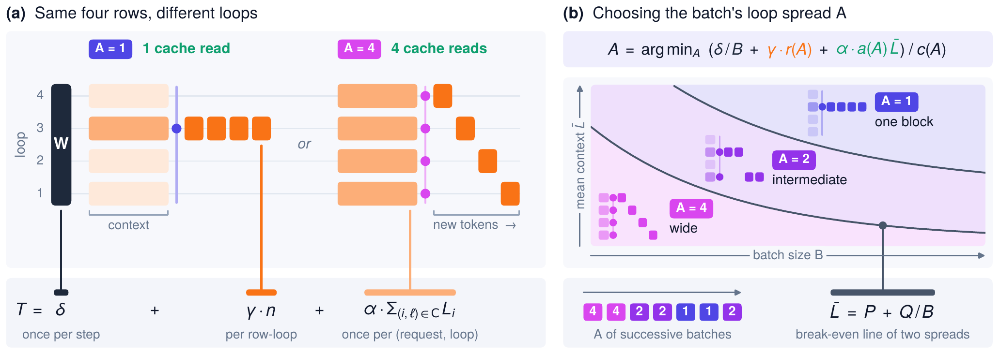

# LoopQuipu: Load-Aware Scheduling for Batched Decoding of Looped Language Models

**Muhan Xiao**<sup>1</sup>, **Shijian Li**<sup>2*</sup>  
<sup>1</sup>College of Artificial Intelligence, Zhejiang University  
<sup>2</sup>College of Computer Science and Technology, Zhejiang University  
<sup>*</sup>Corresponding author (`shijianli@zju.edu.cn`; `humor@zju.edu.cn`)

[[Paper (PDF)]](./LoopQuipu.pdf) [](https://doi.org/10.5281/zenodo.24554123)

<p align="center">
  
</p>
<p align="center">
  <em>Figure 1: Loops share weights W, while each request reads private KV caches across active loop spreads (A=1 vs. A=4). LoopQuipu schedules loop spread dynamically from the batch-context load x = B L̄ / Λ.</em>
</p>

## Overview

Looped language models gain effective depth by iterating a compact set of shared weights across loops while maintaining private KV caches per request and loop. As batch size and context length change, the decoding bottleneck shifts from shared weight reads to private cache traffic, leaving no fixed speculative loop schedule optimal across low and high loads. We introduce **LoopQuipu**, an exact batched decoder that aligns each draft block at a confidence threshold, mixes requests across loops in one forward pass, and selects loop spread from a single normalized cache load.

- **A crossover law for batched looped decoding**: Normalized load $x = B\bar{L}/\Lambda$ orders the measured best loop spreads across non-tied configuration pairs with **99%** accuracy on Ouro models and **97%** on Dory1.0-4B.
- **Exact execution across the full schedule space**: Executes every schedule from draft-then-verify ($A=1$) to wavefront decoding in a single batched pass, matching full-depth greedy or seeded sampled autoregressive decoding token for token in exact arithmetic.
- **Strong speedups across offline and serving loads**: Reaches **99.3%** of the per-configuration measured candidate oracle and **1.94×** geometric-mean speedup over autoregressive decoding across **117** configurations, outperforms the fastest speculative baseline by **8–13%** in geometric mean per model at batch sizes $\ge 32$, and expands continuous serving capacity by **1.18–1.74×**.

## Citation

```bibtex
@misc{xiao2026loopquipu,
  title  = {LoopQuipu: Load-Aware Scheduling for Batched Decoding of Looped Language Models},
  author = {Xiao, Muhan and Li, Shijian},
  year   = {2026},
  doi    = {10.5281/zenodo.24554123},
  url    = {https://github.com/Susuguro/LoopQuipu}
}
```
